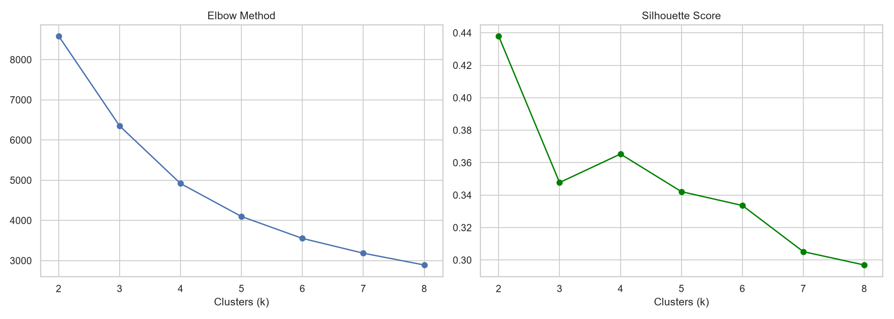
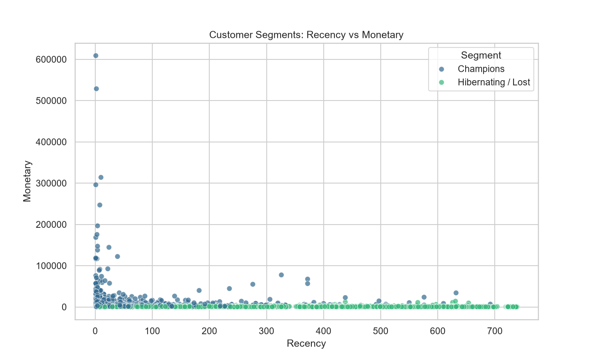
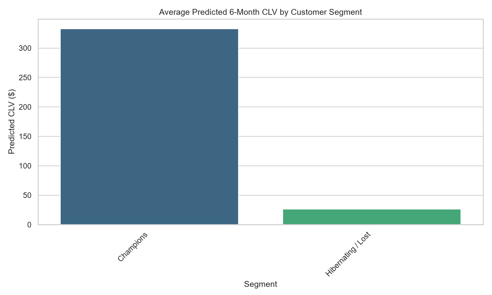

<div align="center">

# 🛒 Customer Segmentation & CLV Prediction

### RFM Analysis → K-Means Clustering → Customer Lifetime Value, served as an interactive Streamlit app

[](https://customer-segmentation-clv-ml.streamlit.app/)


**Dataset (Online Retail II UCI by Miyabon):** [](https://www.kaggle.com/datasets/mashlyn/online-retail-ii-uci)

</div>

---

## 🎯 The Business Problem

Most retailers treat all customers the same — but typically **a small fraction of customers drives most of the revenue**. Blanket marketing spend wastes budget on low-value customers while under-serving the ones who matter.

This project answers three commercial questions:

1. **Who are my best customers?** → RFM scoring
2. **Which behavioural groups exist?** → K-Means clustering
3. **What is each customer worth over time?** → Customer Lifetime Value (CLV)

The output is an **interactive Streamlit app** where stakeholders can explore segments and CLV rankings without touching code.

---

## 🔁 The Pipeline

```text
online_retail_II.csv          (1M+ raw transactions — Kaggle, not stored in repo)
        │
        │  scripts/step1_rfm.py      cleaning + RFM aggregation
        ▼
   data/rfm.csv               (Recency / Frequency / Monetary per customer)
        │
        │  scripts/step2_clustering.py   scaling + K-Means (elbow & silhouette)
        ▼
   data/rfm_segmented.csv     (customers assigned to behavioural clusters)
        │
        │  scripts/step3_clv.py      CLV computation per customer
        ▼
   data/customers_with_clv.csv ──────► app.py  (Streamlit dashboard)
```

Each stage is a **standalone, re-runnable script** — the pipeline can be refreshed end-to-end when new transaction data arrives.

---

## ⚙️ Methodology

### Step 1 · RFM Scoring (`step1_rfm.py`)

Raw transactions are cleaned (cancelled invoices and missing customer IDs removed), then aggregated per customer:

| Metric | Definition |
|---|---|
| **Recency** | Days since the customer's last purchase |
| **Frequency** | Number of distinct orders placed |
| **Monetary** | Total revenue contributed by the customer |

### Step 2 · K-Means Clustering (`step2_clustering.py`)

RFM features are scaled and clustered with **K-Means**. The optimal cluster count is justified — not guessed — using:

- **Elbow method** (within-cluster sum of squares)
- **Silhouette score** (cluster separation quality)



Resulting segments are visualized in RFM space:



### Step 3 · Customer Lifetime Value (`step3_clv.py`)

Each customer is assigned a CLV estimate combining their transaction value, purchase frequency and lifespan, then joined back to their segment:

```text
CLV ≈ (Average Order Value × Purchase Frequency × Gross Margin) × Customer Lifespan
```



---

## 🖥️ The Streamlit App

`app.py` loads `data/customers_with_clv.csv` and lets users:

- Browse customers by **segment** and **CLV tier**
- Compare **segment-level CLV** distributions
- Identify the **highest-value customers** for retention campaigns
- Filter and drill down without writing SQL or Python

```bash
streamlit run app.py
```

---

## 📁 Repository Structure

```text
Customer-Segmentation-CLV/
│
├── app.py                      # Streamlit application (entry point)
├── requirements.txt            # Python dependencies
├── README.md
├── online_retail_II.csv         # Raw data
│
├── data/
│   ├── rfm.csv                 # Step 1 output — RFM table
│   ├── rfm_segmented.csv       # Step 2 output — clustered customers
│   └── customers_with_clv.csv  # Step 3 output — feeds the Streamlit app
│
├── scripts/
│   ├── step1_rfm.py            # cleaning + RFM aggregation
│   ├── step2_clustering.py     # K-Means + elbow/silhouette validation
│   └── step3_clv.py            # CLV computation
│
└── assets/
    ├── elbow_silhouette.png    # cluster-count validation
    ├── segments_scatter.png    # segments in RFM space
    └── clv_by_segment.png      # CLV distribution per segment


## 📖 Data Dictionary (`customers_with_clv.csv`)

| Column | Description |
|---|---|
| `CustomerID` | Unique customer identifier |
| `Recency` | Days since last purchase |
| `Frequency` | Number of orders |
| `Monetary` | Total spend |
| `Cluster / Segment` | K-Means behavioural group assignment |
| `CLV` | Estimated customer lifetime value |

---

## 🛠️ Tech Stack

| Layer | Technology |
|---|---|
| Language | Python |
| Data handling | Pandas, NumPy |
| Clustering | scikit-learn (K-Means, Silhouette) |
| Visualization | Matplotlib / Seaborn |
| Application UI | Streamlit |
| Prototyping | Jupyter Notebook |
| Version control | Git & GitHub |

---

## 💻 Run the Full Pipeline Locally

```bash
# 1. Clone
git clone https://github.com/JatinD18/Customer-Segmentation-CLV.git
cd Customer-Segmentation-CLV

# 2. Environment
python -m venv venv
venv\Scripts\activate          # Windows
pip install -r requirements.txt

# 3. Get the raw data (not stored in repo)
#    Download online_retail_II.csv from Kaggle into the project root

# 4. Run the pipeline in order
python scripts/step1_rfm.py
python scripts/step2_clustering.py
python scripts/step3_clv.py

# 5. Launch the app
streamlit run app.py
```

---

## 📊 Business Decisions This Project Supports

- **Retention budget allocation** — target spend at high-CLV segments instead of the whole base
- **Win-back campaigns** — flag once-loyal customers drifting into high-recency / low-frequency clusters
- **Acquisition targeting** — profile your Champions and find lookalike prospects
- **Revenue concentration risk** — quantify how much revenue depends on the top segment

---

## 🔭 Roadmap

- [ ] Probabilistic CLV (BG/NBD + Gamma-Gamma) instead of historical formula
- [ ] Cohort retention heatmaps
- [ ] Segment-level marketing ROI simulation
- [ ] Scheduled pipeline refresh with new transaction extracts
- [ ] Deploy app to Streamlit Cloud with cached data loading

---

## ⚠️ Limitations

- CLV uses a historical/parametric formula rather than a probabilistic survival model.
- Clusters are behavioural snapshots; segment membership drifts over time and requires periodic re-fitting.
- The Online Retail II dataset is B2B-heavy (some IDs are wholesale accounts), which skews Monetary values upward for a few customers.

---

## 👤 Author

**Jatin Naresh Dolas**
Data Analyst | SQL · Python · Machine Learning · Streamlit

[](https://github.com/JatinD18)
[](https://www.linkedin.com/in/jatin-dolas)
